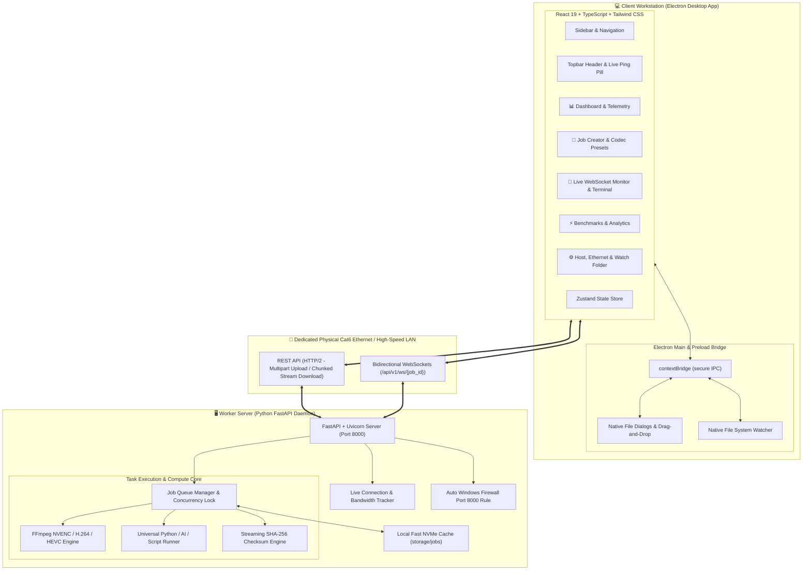

# 🚀 MASTER ARCHITECTURE PROMPT & SYSTEM BLUEPRINT
## Distributed Task Offloading & Remote GPU Rendering Studio
### Modern Architecture Migration: Electron + React + Tailwind CSS + Python FastAPI

---

## 📌 Executive Summary & Objective

You are a **Principal Systems Architect and Full-Stack Desktop Engineer**. Your objective is to architect and implement a production-grade, enterprise-ready desktop application for the **Distributed Task Offloading & Remote GPU Rendering System**.

The current prototype relies on Python CustomTkinter. The new system transitions to a decoupled, ultra-responsive hybrid architecture:
* **Frontend Workstation Shell**: **Electron + React + TypeScript + Tailwind CSS** delivering a modern, glassmorphic, 60fps dark/light interface with dynamic telemetry sparklines, drag-and-drop file offloading, and real-time WebSocket job streaming.
* **Backend Compute Engine & Worker Daemon**: **Python 3.11+ / FastAPI / Uvicorn** running on the host/worker GPU machine, orchestrating hardware-accelerated FFmpeg (NVIDIA NVENC, QuickSync, AMD AMF, CPU libx264/265 fallback), universal Python/AI compute execution, streaming uploads/downloads with SHA-256 integrity verification, and automatic Windows Defender Firewall configuration over high-speed physical Ethernet.

---

## 🏗️ 1. High-Level System Architecture



---

## 🛠️ 2. Technology Stack & Directory Structure

### Client Desktop Shell (Frontend)
* **Runtime**: Electron 33+ (Node.js 22 LTS)
* **Framework**: React 19 + TypeScript 5.5+
* **Build Tool**: Vite 6+
* **Styling**: Tailwind CSS v3.4+ with Glassmorphism, CSS Custom Properties & Dark Mode
* **State Management**: Zustand (lightweight, reactive global state)
* **Icons**: Lucide React
* **Animations**: Framer Motion (smooth tab transitions, progress waves, pulse pills)
* **Charts & Sparklines**: Recharts or Chart.js for throughput waves & latency sparklines
* **Terminal Component**: Xterm.js or custom ANSI-parsed log console
* **HTTP & WebSocket**: Axios or native `fetch` with streaming response support + native WebSocket

### Compute Server & Daemon (Backend)
* **Runtime**: Python 3.11 / 3.12 / 3.13 / 3.14
* **Framework**: FastAPI + Starlette
* **ASGI Server**: Uvicorn (multi-threaded, asyncio event loop)
* **Process Management**: `asyncio.subprocess` (non-blocking FFmpeg execution and stderr parsing)
* **Hardware Telemetry**: `psutil` + `subprocess` NVIDIA SMI query
* **Encoding Engine**: FFmpeg static build + `imageio-ffmpeg` fallback
* **Packaging**: PyInstaller for standalone zero-dependency server binary (`GPUWorkerServer.exe`)

### Proposed Project Repository Structure
```
Distributed-Task-Offloading/
├── client-electron/                 # Modern Desktop Client Application
│   ├── electron/
│   │   ├── main.ts                  # Electron main entrypoint (window lifecycle, tray)
│   │   ├── preload.ts               # Secure contextBridge API for native OS access
│   │   ├── watchFolderService.ts    # Native directory polling / watcher automation
│   │   └── menu.ts                  # Native application menus
│   ├── src/
│   │   ├── assets/                  # Icons, illustrations, sound cues
│   │   ├── components/
│   │   │   ├── common/              # Button, Card, Badge, Modal, Input, Progress
│   │   │   ├── layout/              # Sidebar, Topbar, StatusPill, LatencyBadge
│   │   │   ├── dashboard/           # GpuCard, CpuCard, StorageGauge, NodeCard
│   │   │   ├── monitor/             # LiveCircularGauge, LogTerminal, StatCounter
│   │   │   └── charts/              # TelemetrySparkline, ThroughputWaveChart
│   │   ├── views/
│   │   │   ├── DashboardView.tsx    # Live hardware overview and quick metrics
│   │   │   ├── CreateJobView.tsx    # Drag-and-drop file upload & codec configuration
│   │   │   ├── ActiveJobView.tsx    # Live WebSocket execution monitor & cancel controls
│   │   │   ├── BenchmarksView.tsx   # Historical job stats, benchmarks, speed comparison
│   │   │   └── SettingsView.tsx     # Worker IP configuration, direct cable test, token
│   │   ├── services/
│   │   │   ├── apiClient.ts         # Axios/Fetch REST client with multipart streaming
│   │   │   ├── wsClient.ts          # Resilient WebSocket connection manager
│   │   │   └── hashService.ts       # Streaming chunked SHA-256 calculator
│   │   ├── store/
│   │   │   ├── connectionStore.ts   # Worker host/port, online status, ping latency
│   │   │   ├── jobStore.ts          # Active jobs, upload progress, history benchmarks
│   │   │   └── settingsStore.ts     # User preferences, themes, fallback toggles
│   │   ├── types/
│   │   │   └── index.ts             # Strict TypeScript schemas matching server models
│   │   ├── App.tsx                  # Root layout, routing and heartbeat orchestrator
│   │   ├── main.tsx                 # React DOM mount point
│   │   └── index.css                # Tailwind imports and design system tokens
│   ├── package.json
│   ├── vite.config.ts
│   ├── tailwind.config.js
│   └── electron-builder.json5       # Packaging configuration for Windows installer
│
├── server/                          # High-Performance Python Compute Daemon
│   ├── app/
│   │   ├── api/
│   │   │   ├── health.py            # /api/v1/health & /api/v1/ping
│   │   │   ├── jobs.py              # /api/v1/jobs CRUD, streaming upload/download
│   │   │   └── websocket.py         # /api/v1/ws/{job_id} live telemetry stream
│   │   ├── services/
│   │   │   ├── ffmpeg_service.py    # Hardware encoder validation & command builder
│   │   │   ├── job_manager.py       # Async job queue, concurrency locks, log broadcaster
│   │   │   ├── system_service.py    # Physical Ethernet detection, telemetry, auto-firewall
│   │   │   └── connection_tracker.py# Client bandwidth metrics & active IP tracker
│   │   ├── config.py                # Pydantic v2 settings (.env support)
│   │   ├── main.py                  # FastAPI application factory & middleware
│   │   └── server_state.py          # Daemon active/pause lifecycle state
│   ├── ui/                          # Optional lightweight CustomTkinter/Tray server GUI
│   ├── server_entrypoint.py         # PyInstaller entrypoint
│   └── requirements.txt
│
├── shared/                          # Unified Protocol Specifications
│   └── schemas.py                   # Pydantic schemas & protocol versioning
│
├── scripts/
│   ├── start_dev.bat                # Concurrently launches Vite + Electron + FastAPI
│   └── allow_firewall_port_8000.bat # Native Windows firewall configuration
└── README.md
```

---

## 🎨 3. Design System & Aesthetic Tokens

The application must reflect a **luxurious, dark-mode-first developer aesthetic** inspired by Linear, Raycast, and Vercel.

### Color Palette (Tailwind Tokens)
```javascript
module.exports = {
  darkMode: 'class',
  theme: {
    extend: {
      colors: {
        background: '#090D16',       // Deep rich obsidian navy
        surface: {
          DEFAULT: '#111827',        // Primary card background
          hover: '#1F2937',          // Hover state
          alt: '#0B0F19',            // Dark inset wells
        },
        border: {
          DEFAULT: '#1E293B',        // Subtle card border
          active: '#3B82F6',         // Focused input border
        },
        accent: {
          blue: '#3B82F6',           // Primary action color
          green: '#10B981',          // Success, Online status, FPS
          orange: '#F59E0B',         // Warning, Transcode in progress
          purple: '#8B5CF6',         // Universal AI/Script compute
          red: '#EF4444',            // Error, Cancel, Disconnected
          cyan: '#06B6D4',           // Download phase
        },
        text: {
          primary: '#F8FAFC',        // High-contrast headings
          secondary: '#94A3B8',      // Body text and labels
          muted: '#64748B',          // Captions and timestamps
        }
      }
    }
  }
}
```

---

## 🖥️ 4. Granular Page & Component Specifications

### 1. Master Layout & Persistent Frame
* **Sidebar (`Sidebar.tsx`)**:
  * Collapsible left panel with SVG glowing icons.
  * Nav links: **Dashboard**, **Create Job**, **Live Monitor**, **Benchmarks**, **Settings**.
  * Dynamic Engine Status Pill: Shows `● NVENC Ready` (emerald green) or `● CPU Fallback` (amber) driven by real-time worker capabilities.
* **Topbar Header (`Topbar.tsx`)**:
  * Node connection pill:
    * **Online State**: Glowing green pulse `● Worker Online | 169.254.46.82:8000 (0.2 ms)`.
    * **Offline State**: Glowing red pulse `● Worker Offline | Click to Reconnect`.
  * Quick reconnect button, current time indicator, and theme switcher (Dark / Light / OLED mode).

---

### 2. View 1: Dashboard (`DashboardView.tsx`)
* **Top Metric Grid (4 Cards)**:
  1. **Compute Engine Status**: Active worker GPU Model (e.g. `NVIDIA GeForce RTX 4070`), Driver version, CUDA readiness.
  2. **Active Node Telemetry**: Live CPU utilization (with circular progress gauge) & Physical/Logical core count.
  3. **Shared Memory (VRAM / RAM)**: Used vs Installed RAM in GB with a dynamic colored progress meter.
  4. **Network Link Speed**: Displays current connected transport (`Direct Cat6 Ethernet • 100/1000 Mbps`) with round-trip latency.
* **Active Queue Preview**:
  * Mini-table of active rendering tasks with live progress bars.
* **Throughput Wave Chart**:
  * Real-time canvas/SVG area sparkline showing live transcode speed (FPS) and transfer throughput (MB/s).

---

### 3. View 2: Create & Offload Job (`CreateJobView.tsx`)
* **Interactive Drag-and-Drop Dropzone**:
  * Accepts single videos (`.mp4`, `.mov`, `.mkv`, `.avi`, `.flv`, `.webm`) OR script/batch files (`.py`, `.ps1`, `.bat`, `.zip`).
  * Instant client-side metadata extraction (filesize, format, duration, audio channels).
* **Execution Profile Switcher**:
  * Tab 1: **🎬 Video Transcode (GPU NVENC)**
    * **Resolution Dropdown**: `Original (Pass-Through)`, `720p (HD)`, `1080p (Full HD)`, `1440p (2K)`, `4K (Ultra HD)`.
    * **Target Bitrate**: `2 Mbps`, `5 Mbps (Recommended)`, `8 Mbps`, `15 Mbps`, `Custom`.
    * **Encoder Preset**: `P1 - Fastest`, `P4 - Balanced (Recommended)`, `P7 - Maximum Quality`.
    * **Audio Stream**: `AAC 192 kbps (Standard)`, `Copy Audio (No Transcode)`.
  * Tab 2: **🧠 Universal Python / AI Compute**
    * Custom entrypoint execution (e.g. `python train.py --epochs 50`).
    * Direct multi-thread execution using 100% server hardware.
* **Output Destination Picker**:
  * Native Electron file dialog to select local download directory (defaults to `Downloads/RenderOutput`).
* **Instant Submission Button**:
  * `🚀 Submit & Run on Server Hardware (0% Laptop Load)`.

---

### 4. View 3: Live Execution Monitor (`ActiveJobView.tsx`)
* **3-Phase Execution Stepper**:
  * `Phase 1: Streaming Upload` ➔ `Phase 2: Remote GPU Render` ➔ `Phase 3: Downloading Finished Output`.
* **Central Radial / Linear Progress Bar**:
  * Displays smooth 0.0% to 100.0% completion.
* **Live Telemetry Banner**:
  * **Render Speed Multiplier**: (e.g. `3.8x Real-Time`).
  * **Frames Per Second**: (e.g. `142 FPS`).
  * **Elapsed Time** & **Dynamic ETA Clock**: (e.g. `Elapsed: 00:32 | ETA: 00:14`).
  * **Server Live CPU & RAM**: Two mini horizontal meters showing load on the remote worker during the render.
* **Real-time Terminal Output (`LogTerminal.tsx`)**:
  * Auto-scrolling terminal window displaying stderr logs streamed line-by-line over WebSocket.
  * Filter pills: `All`, `Info`, `Warning`, `Error`.
  * Buttons: `📋 Copy Logs`, `🧹 Clear Console`.
* **Emergency Action Control**:
  * Thread-safe **✕ Cancel Job** button with confirmation modal.

---

### 5. View 4: Benchmarks & History (`BenchmarksView.tsx`)
* **Session Summary Metrics**:
  * Total Jobs Rendered, Cumulative Megabytes Processed, Total Time Saved vs Laptop CPU.
* **Interactive Job History Table**:
  * Columns: `#`, `Filename`, `Input Size`, `Time (Upload / Render / Download)`, `Total Duration`, `Output Checksum`, `Actions (Open Folder, Re-Run)`.
* **Speedup Comparison Gauge**:
  * Visual comparative bar comparing remote GPU render duration against estimated local CPU time.

---

### 6. View 5: Host & Settings (`SettingsView.tsx`)
* **Network & Worker Connection Card**:
  * **Worker Host IP Input**: With direct Ethernet helper tip (e.g. `169.254.46.82` or static `192.168.10.1`).
  * **Port Input**: Default `8000`.
  * **API Token Input**: Password-masked token input.
  * **Buttons**:
    * `🔄 Test & Connect`: Sends live ping + health check probe.
    * `🔌 Disconnect`: Gracefully sets offline mode without wiping configuration.
    * `⏮ Reset to Default`: Restores localhost defaults.
* **3rd-Party Watch Folder Automation**:
  * Toggle switch: `Enable Watch Folder Auto-Offloading`.
  * Directory selector: Folder path where any newly pasted video is instantly hashed, uploaded, and rendered in the background.
* **Encoder Fallback Preference**:
  * Checkbox: `Allow CPU Software Fallback (libx264) if GPU is unavailable`.

---

## 📡 5. API & WebSocket Communication Protocol

### 1. Health & Node Capabilities
* **Endpoint**: `GET /api/v1/health`
* **Response Contract**:
```typescript
interface HealthResponse {
  status: "online";
  protocol_version: "v1.0.0";
  server_time: string;
  ffmpeg: {
    available: boolean;
    version: string;
    nvenc_available: boolean;
    supported_encoders: string[]; // ['h264_nvenc', 'hevc_nvenc', 'libx264', ...]
  };
  hardware: {
    hostname: string;
    os_platform: string;
    cpu_model: string;
    cpu_cores: number;
    cpu_percent: number;
    ram_total_gb: number;
    ram_used_gb: number;
    ram_percent: number;
    gpu_detected: boolean;
    gpu_name?: string;
    gpu_vram_total_mb?: number;
    gpu_vram_used_mb?: number;
    gpu_util_percent?: number;
  };
  limits: {
    max_upload_size_bytes: number;
    max_concurrent_jobs: number;
    active_jobs: number;
  };
}
```

### 2. Job Creation & Multipart Streaming Upload
* **Endpoint**: `POST /api/v1/jobs`
* **Form-Data**:
  * `file`: Binary stream
  * `checksum`: SHA-256 hex string
  * `resolution`: e.g. `"1080p"`
  * `bitrate`: e.g. `"5M"`
  * `preset`: e.g. `"p4"`
  * `output_filename`: e.g. `"output_video.mp4"`
  * `allow_cpu_fallback`: `"true"`

### 3. Real-Time Telemetry WebSocket
* **Endpoint**: `ws://{host}:{port}/api/v1/ws/{job_id}?token={api_token}`
* **Message Types Received by Client**:
```typescript
type WSMessage =
  | {
      type: "progress";
      job_id: string;
      status: "rendering";
      percent: number;          // 0.0 to 100.0
      elapsed_seconds: number;
      eta_seconds: number;
      speed: string;            // e.g. "3.5x"
      fps: number;              // e.g. 144
      server_telemetry?: {
        cpu_percent: number;
        ram_percent: number;
        ram_used_gb: number;
        ram_total_gb: number;
      };
    }
  | {
      type: "log";
      job_id: string;
      level: "INFO" | "WARNING" | "ERROR";
      message: string;
    }
  | {
      type: "state";
      job_id: string;
      status: "completed" | "failed" | "cancelled";
      output_checksum?: string;
      output_size_bytes?: number;
      total_render_seconds?: number;
      message?: string;
    }
  | {
      type: "error";
      job_id: string;
      error: string;
    };
```

### 4. Streaming Artifact Download
* **Endpoint**: `GET /api/v1/jobs/{job_id}/download`
* **Headers**: `X-Checksum-SHA256: <expected-hash>`
* **Behavior**: Chunked stream validated locally by client hasher upon full reception.

---

## ⚡ 6. High-Reliability Networking & Heartbeat Strategy

### Resilient Heartbeat Specification (Preventing False Disconnects)
1. **Adaptive Timeout**: Heartbeat interval is **2.5 seconds** with a generous **4.0-second network timeout**.
2. **Failure Dampening (3-Strike Rule)**: Client must observe **3 consecutive failed probes** (total 8-12 seconds of true packet silence) before transitioning state to `Disconnected`.
3. **Self-Healing Auto-Reconnect**: As long as the user did not explicitly press `Disconnect`, the background worker thread continuously polls every 3.0 seconds and **automatically reconnects** and restores full telemetry when the worker responds.
4. **Physical Ethernet Direct Cable Priority**:
   * Windows APIPA (`169.254.x.x`) on Cat6 cable must be auto-detected and prioritized over Wi-Fi to eliminate campus/office Access Point isolation timeouts.
   * Auto-Firewall Rule script executes on the host daemon to permanently allow inbound TCP 8000.

---

## 📋 7. Step-by-Step Migration & Build Instructions

Follow this roadmap when executing the migration:

### Phase 1: Initialize Electron + Vite + React Foundation
1. In `client-electron/`, initialize project:
   ```bash
   npx -y create-vite@latest . --template react-ts
   npm install
   npm install -D electron electron-builder vite-plugin-electron vite-plugin-electron-renderer
   npm install -D tailwindcss postcss autoprefixer
   npx tailwindcss init -p
   npm install lucide-react clsx tailwind-merge framer-motion zustand axios
   ```
2. Configure `vite.config.ts` with `vite-plugin-electron` to compile `electron/main.ts` and `electron/preload.ts`.
3. Configure `electron/preload.ts` to expose native file pickers and path resolution via `window.electronAPI`.

### Phase 2: Implement Component Architecture & Design System
1. Build `index.css` with dark Obsidian palette tokens.
2. Build `Sidebar` and `Topbar` persistent layout.
3. Construct `DashboardView` with real-time hardware telemetry gauges.
4. Construct `CreateJobView` with drag-and-drop dropzone and codec selectors.
5. Construct `ActiveJobView` with animated radial progress, FPS counters, and `LogTerminal`.
6. Construct `SettingsView` with resilient heartbeat status and direct Ethernet detection.

### Phase 3: Connect API & WebSocket Services
1. Implement `apiClient.ts` with axios upload progress streaming and chunked download hasher.
2. Implement `wsClient.ts` to manage real-time WebSocket connection lifecycle with reconnection backoff.
3. Implement `connectionStore.ts` with the 3-strike failure buffer and self-healing auto-reconnect.

### Phase 4: Production Packaging
1. Build Windows NSIS installer using `electron-builder`:
   ```bash
   npm run build
   npx electron-builder --win
   ```
2. Ensure standalone `GPUWorkerServer.exe` and `GPURenderStudio.exe` can run side-by-side or across separate physical laptops linked via Cat6 Ethernet cable.

---

## ✅ Deliverable Verification Checklist
* [ ] Single or dual-PC setups connect over physical Ethernet cable with 0.2ms ping latency.
* [ ] UI renders at 60fps with zero UI stuttering during heavy video upload or download.
* [ ] FFmpeg NVENC processes videos with live FPS and speed multiplier streamed to the client.
* [ ] SHA-256 checksums are verified on both upload and download to guarantee zero file corruption.
* [ ] Server stays connected throughout the render and automatically resumes status without disconnects.
